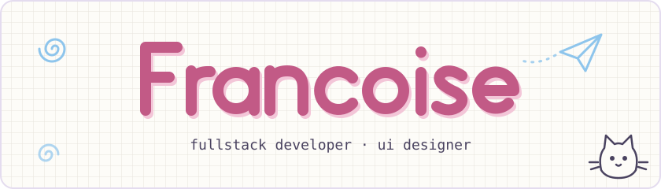
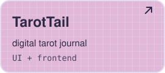
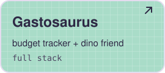
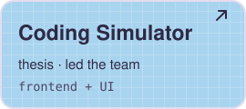

  

  

## About

Hi, I'm Francoise, a Computer Science student at Holy Angel University. I build across the whole stack, from the first Figma frame to the database underneath it. I also build automations that take repetitive admin work off a team's plate.

The part I like most is where design and code meet: making something feel friendly, then making sure it actually holds up.

## Tech stack

  
  
  
  
  
  
  
  

## Featured work

  
  
  

  code: <a href="https://github.com/goingmeri/Tarotail">TarotTail</a> · <a href="https://github.com/francoiseee/gastosaurus">Gastosaurus</a> · <a href="https://github.com/francoiseee/Coding-Simulator">Coding Simulator</a>

More on my <a href="https://francoise-portfolio.vercel.app/">portfolio</a> ✦

## GitHub stats

  
  

  

## Let's connect

  
  
  

— Francoise &amp; her cat 🐾

